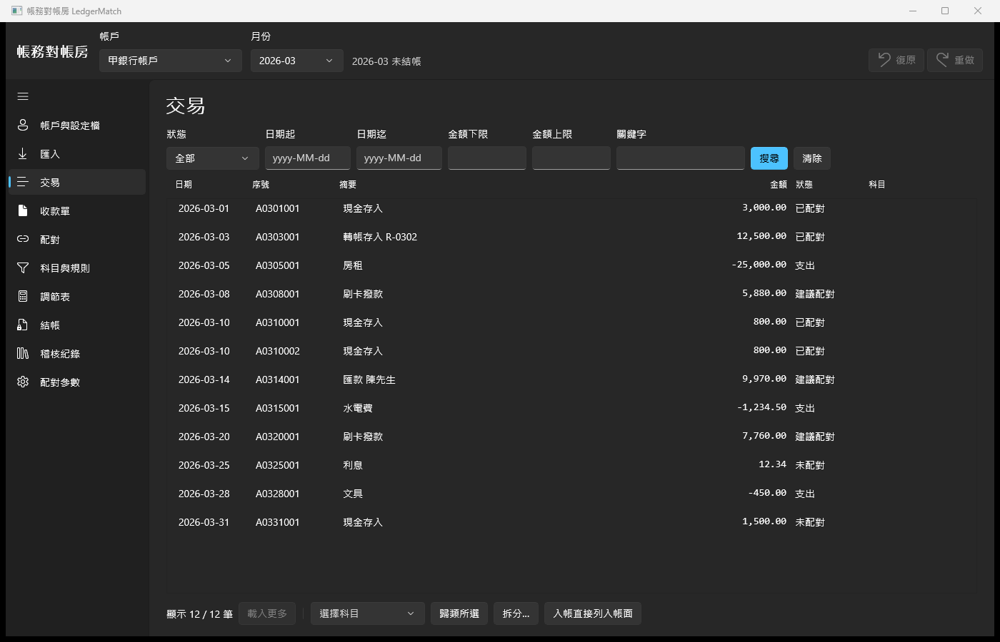
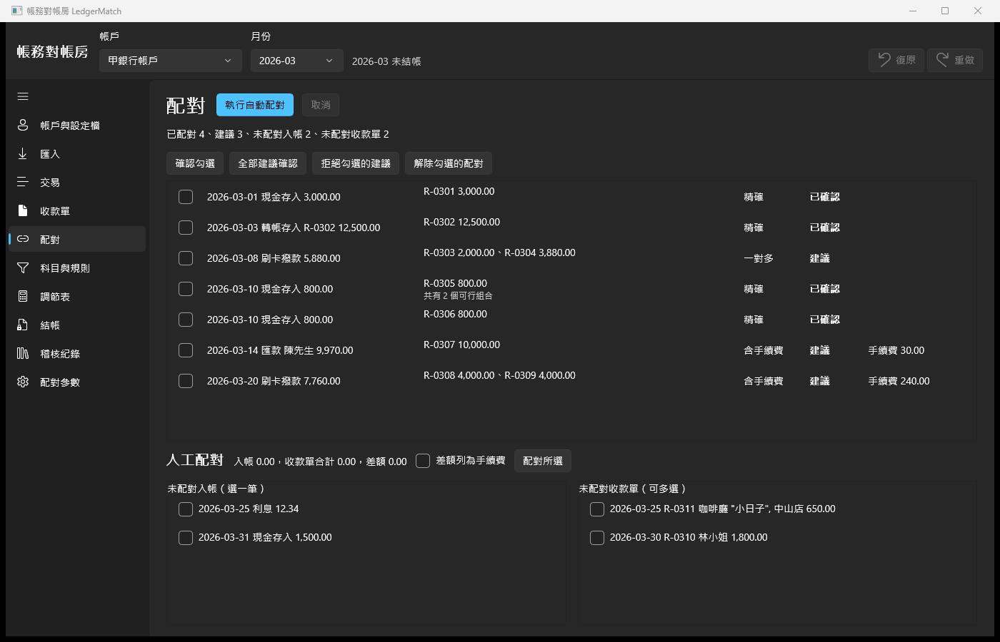
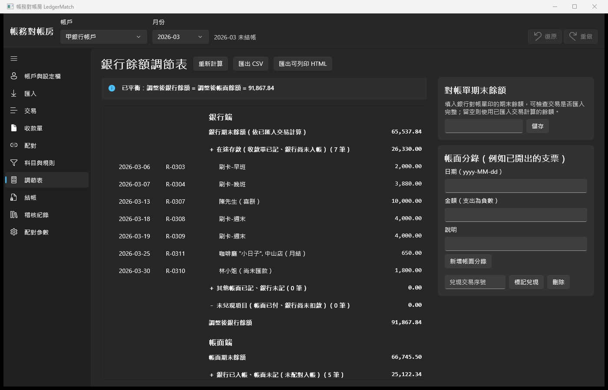
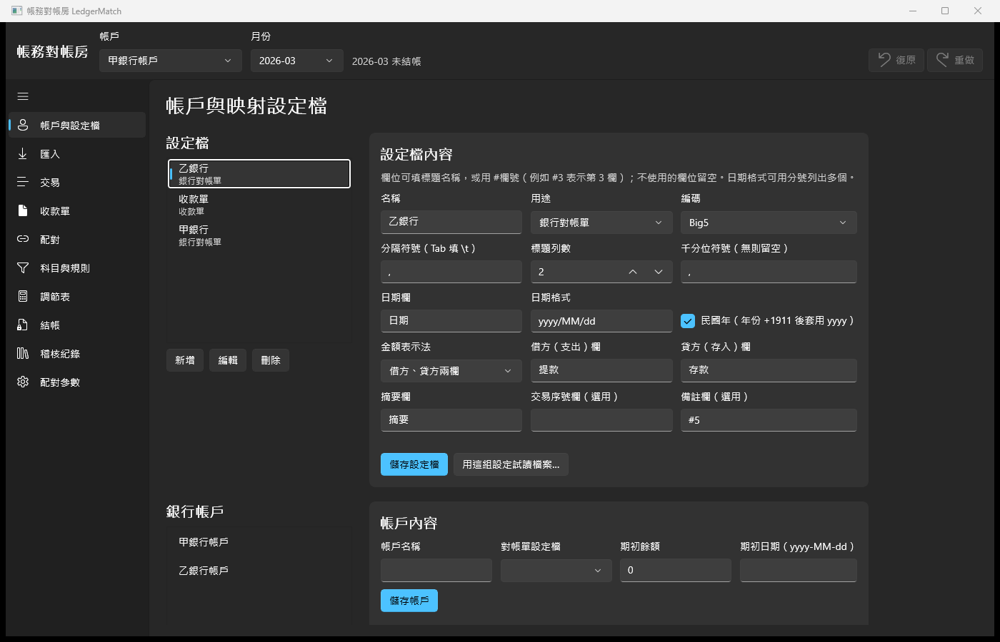
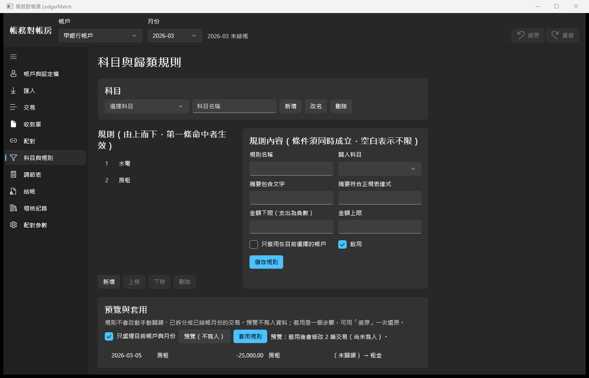
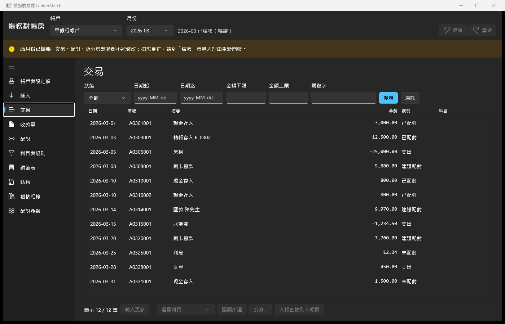
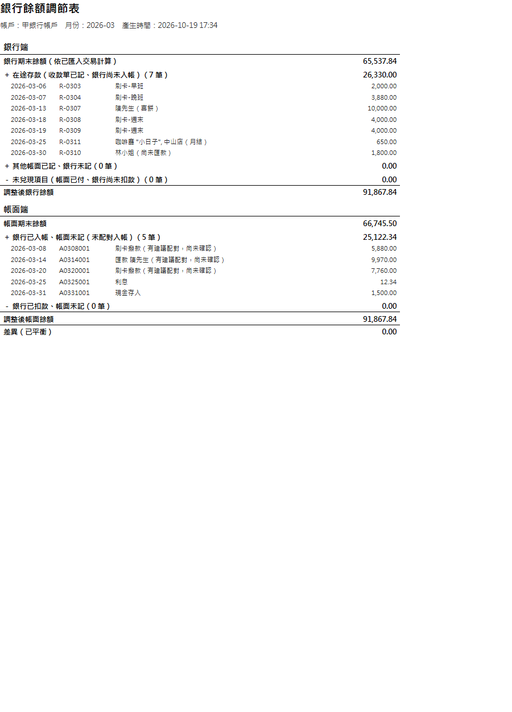
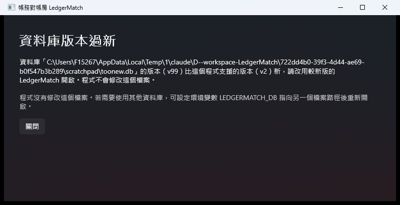

# 帳務對帳房 LedgerMatch

[](https://github.com/hn83320589/LedgerMatch/actions/workflows/ci.yml)

給小型店家（例如三人烘焙坊）的 Windows 桌面對帳工具。功能包括：匯入兩家銀行格式不同的對帳單與自己開的收款單，自動配對並標出對不上的項目，支出可以歸類、拆分，月底產出能交給會計師的銀行餘額調節表，最後結帳鎖定該月。

- C# / .NET 9 / WinUI 3（Windows App SDK 1.8，unpackaged）/ MVVM（CommunityToolkit.Mvvm）
- 本機 SQLite（Microsoft.Data.Sqlite），有 schema 版本管理與損毀偵測
- 金額一律用整數「分」（`Money`）；「現在時間」一律經 `TimeProvider` 注入
- 326 個自動化測試，其中 4 組是固定亂數種子的性質測試，另有 4 個十萬筆資料的效能測試

---

## 目錄

1. [畫面](#畫面)
2. [建置與執行](#建置與執行)
3. [使用流程](#使用流程)
4. [模組與架構](#模組與架構)
5. [演算法](#演算法)：冪等判斷、配對與組合搜尋、拆分分配、調節表
6. [配對參數](#配對參數)
7. [效能實測](#效能實測)
8. [測試](#測試)
9. [設計取捨](#設計取捨)
10. [已知限制](#已知限制)
11. [驗收標準對照](#驗收標準對照)

---

## 畫面

| 交易清單（虛擬化、篩選） | 配對工作台 |
|---|---|
|  |  |

| 銀行餘額調節表 | 映射設定檔（Big5、借貸雙欄、民國年） |
|---|---|
|  |  |

| 規則預覽（dry-run） | 已結帳月份：唯讀、編輯按鈕停用 |
|---|---|
|  |  |

| 匯出的 HTML 在瀏覽器列印（單頁 A4 直式） | 資料庫版本過新時的提示 |
|---|---|
|  |  |

截圖使用 `samples/` 的範例資料（2026 年 3 月）。

---

## 建置與執行

### 需求

- Windows 10 1809（17763）以上、x64
- .NET 9 SDK（`global.json` 指定 9.0.x，`rollForward: latestFeature`）

不需要安裝 Visual Studio，Windows App SDK 由 NuGet 還原。

### 指令

```powershell
dotnet build LedgerMatch.sln                                 # 建置全部專案
dotnet test LedgerMatch.sln --filter "Category!=Perf"        # 單元、整合、性質測試（322 個）
dotnet test tests/LedgerMatch.Perf.Tests --filter Category=Perf   # 十萬筆效能測試（約 5 秒）

# 執行程式
dotnet run --project src/LedgerMatch.App

# 發佈 win-x64 自含版（CI 上傳的 artifact 就是這個資料夾）
dotnet publish src/LedgerMatch.App -c Release -r win-x64 --self-contained -o artifacts/publish/win-x64
```

### 資料庫位置

- 預設為 `%LocalAppData%\LedgerMatch\ledger.db`。
- 設定環境變數 `LEDGERMATCH_DB` 可以改用其他檔案（測試、示範時方便）。
- 升級 schema 前會先備份為 `ledger.db.bak-v{舊版本}`。

### 示範資料庫

```powershell
dotnet run --project tools/LedgerMatch.DataGen -- demo  $env:TEMP\demo.db samples
$env:LEDGERMATCH_DB = "$env:TEMP\demo.db"; dotnet run --project src/LedgerMatch.App
```

`demo` 指令會透過正式的服務層建立兩個帳戶與設定檔、匯入四個對帳單與收款單、建立兩條規則並執行配對。

DataGen 的其他指令：

| 指令 | 用途 |
|---|---|
| `bulk <db> [筆數=100000] [seed=42]` | 產生十萬筆交易的資料庫（固定亂數種子，不提交到 repo） |
| `month-csv <csv> [列數=5000] [seed=7] [yyyy-MM]` | 產生單月對帳單 CSV，用來量測匯入時間 |
| `report <db> <帳戶名稱> <yyyy-MM> <輸出資料夾>` | 不開 UI 直接匯出調節表 CSV 與 HTML |

---

## 使用流程

1. **帳戶與設定檔**：為每家銀行建立「映射設定檔」，填入編碼（UTF-8 / Big5）、分隔符號、標題列數、日期欄與格式（可多個、可選民國年）、金額表示法（單一正負金額欄，或借方、貸方兩欄）、摘要、序號、備註、千分位、括號負數。按「用這組設定試讀檔案」，可以先看解析結果與錯誤列的行號再存檔。建立帳戶時選擇設定檔並輸入期初餘額。
2. **匯入**：匯入對帳單時在背景執行，可以取消。結束後顯示摘要（新增、重複略過、錯誤列的行號與原因）。收款單用收款單設定檔匯入；若有「入帳帳戶」欄，就依每列的帳戶名稱歸屬。
3. **配對**：執行自動配對（背景執行、顯示進度、可取消）。精確配對會自動確認；一對多與含手續費的配對列為「建議」，可以逐筆或批次確認、拒絕，也可以人工配對或解除配對。
4. **交易**：依狀態、日期、金額、關鍵字篩選。可以批次歸類、拆分（輸入金額或按比例，畫面即時預覽到分），沒有收款單的入帳（例如利息）可以直接列入帳面。
5. **科目與規則**：規則可以設定摘要包含文字或正規表達式、金額區間、帳戶等條件，並可調整優先序。先「預覽」看會改哪些交易（不寫入），「套用」只算一個步驟。
6. **調節表**：可以輸入對帳單印的期末餘額來檢查有沒有漏匯，也可以新增帳面分錄（例如開出的支票）並標記兌現。可匯出 CSV（UTF-8 with BOM）與可列印的 HTML。
7. **結帳**：結帳後該月不能修改。晚到的交易會進入待處理佇列，可以改列入下一個未結帳月份（保留原日期）或捨棄。重新開帳必須輸入理由。
8. **稽核紀錄**：唯讀清單，並可驗證雜湊鏈是否完整。
9. 全程可以 **復原／重做**（Ctrl+Z / Ctrl+Y，至少 50 層）。

範例資料與每個預期數字（匯入筆數、配對結果、各月調節表）寫在 [`samples/expected-results.md`](samples/expected-results.md)，並由 `SampleDataTests` 自動驗證。

---

## 模組與架構

```
LedgerMatch.sln
├─ src/LedgerMatch.Core           net9.0  領域模型、演算法、應用服務、Port 介面（不引用 UI 或 SQLite）
├─ src/LedgerMatch.Data           net9.0  SQLite：migration、ChangeSet 套用、查詢、觸發器
├─ src/LedgerMatch.Presentation   net9.0  ViewModel（CommunityToolkit.Mvvm），只依賴 Core
├─ src/LedgerMatch.App            WinUI 3 unpackaged；View（x:Bind）、對話框、檔案挑選器
├─ tests/LedgerMatch.Core.Tests          純邏輯單元測試與性質測試
├─ tests/LedgerMatch.Data.Tests          服務 + 真實 SQLite 整合測試、範例資料端到端測試
├─ tests/LedgerMatch.Presentation.Tests  ViewModel 測試（假對話框、假檔案、真實 SQLite）
├─ tests/LedgerMatch.Perf.Tests          十萬筆效能測試（Category=Perf）
├─ tools/LedgerMatch.DataGen             示範資料庫、大量測試資料、離線匯出報表
└─ samples/                              範例 CSV 與預期結果
```

```
App ──► Presentation ──► Core ◄── Data
 └──────────── 組裝（composition root）────┘
```

### Core 的主要模組

| 命名空間 | 內容 |
|---|---|
| `Importing` | RFC 4180 `CsvReader`、`MappingProfile`、`AmountParser`、`DateParser`（含民國年）、對帳單／收款單解析器、`ImportPlanner`（冪等判斷）、`StatementImportService` |
| `Matching` | `MatchingEngine`（三階段、純函式、決定性）、`MatchingSettings`、`MatchingService` |
| `Classification` | `Allocation`（最大餘數法）、`RuleEngine`、科目、歸類與拆分、規則服務 |
| `Periods` | 結帳、重新開帳、待處理佇列 |
| `Books` | 帳面分錄、直接入帳、對帳單期末餘額 |
| `Reporting` | `ReconciliationCalculator`、`ReconciliationLayout`（畫面、CSV、HTML 共用）、匯出 |
| `Persistence` | `ChangeSet`、`LedgerCommandExecutor`、`PeriodGuard`、稽核雜湊鏈、Port 介面 |
| `History` | `UndoRedoService` |

### 寫入路徑：ChangeSet

所有修改性操作都轉成一個 `ChangeSet`（逐列的前值與後值），交給 `LedgerCommandExecutor`：

1. `PeriodGuard` 檢查 Before / After 是否落在已結帳月份，是的話直接拒絕。
2. 在同一個 SQLite transaction 裡套用變更並寫入稽核紀錄（含前後值 JSON 與 SHA-256 雜湊鏈）。
3. Update / Delete 的 SQL 以 `WHERE 每個欄位 IS 前值` 比對（樂觀並行控制）。資料已被改過時整筆拒絕，不會覆蓋。

復原就是把 ChangeSet 反向後再走同一條路，所以復原本身也會留下稽核紀錄，也會被結帳擋下。統計與餘額一律即時查詢、不存快取，因此復原後自然同步。

### 資料庫

- `PRAGMA user_version` 記錄 schema 版本，嵌入式 `V###__name.sql` 依序升級，每個版本一個 transaction，升級前先備份。目前有 V001、V002。
- `PRAGMA application_id` 標記檔案是 LedgerMatch 的資料庫。版本過新、損毀或不是本程式的檔案時，會顯示說明視窗，且不修改檔案。
- 使用 WAL 模式，背景寫入時 UI 仍可讀取。
- 觸發器：`audit_log` 擋下 UPDATE 與 DELETE；已結帳月份的交易、配對、拆分、收款單、帳面分錄會被擋下寫入（應用層檢查之外的第二道防線）。

---

## 演算法

### 冪等判斷（匯入）

每筆交易有一個 `DedupKey`，在同一帳戶內唯一（資料庫有 UNIQUE 索引）：

| 對帳單 | DedupKey |
|---|---|
| 有交易序號欄 | `S|{序號}` |
| 沒有序號欄 | `N|{日期}|{金額(分)}|{摘要正規化}|{第幾次出現}` |

- **摘要正規化**：Unicode NFKC（全形轉半形）、去除頭尾空白、連續空白合併為一個。
- **第幾次出現**：同一個檔案裡，相同（日期, 金額, 摘要）依檔案列順序編號 1, 2, 3…。

因此每組（日期, 金額, 摘要）最後保留的筆數 = **各檔案中該組筆數的最大值**：

- 同一檔案匯入兩次：編號 1..k 都已存在，新增 0 筆。
- 兩個重疊檔案（1–15 日、10–31 日）：重疊日在兩個檔案裡筆數相同，不會重複。
- 同一天、同金額、同摘要的多筆真實交易：編號不同，全部保留。
- `max` 有交換律、結合律、冪等性，所以**匯入順序不影響結果**。性質測試會隨機切出重疊檔案、以隨機順序重複匯入 300 次，每次都比對最終集合（有序號與無序號各一組）。

日期落在已結帳月份的列不會入帳，而是放進待處理佇列；待處理項目的 key 也會參與重複判斷，所以重新匯入不會再產生一次。

**交易序號的假設：序號在帳戶內唯一**（不只在一個月或一個檔案內）。比對既有資料時直接用 key 查詢，不受檔案日期範圍限制，因為同一個序號可能早已以其他日期存在。序號已被使用時：

- 日期、金額、正規化後摘要都相同 → 視為同一筆，計入「重複略過」。
- 任何一項不同 → 這一列列為**錯誤列**，訊息指出行號、序號、以及既有交易的日期、金額和摘要；其他列照常匯入。例如銀行每月從頭編號，或銀行事後更正了入帳日，都會在匯入摘要中看到，而不是被悄悄略過或讓整批失敗。

如果某家銀行的序號會重複使用，請在映射設定檔中不要設定序號欄，改用無序號的 key。

### 配對引擎與組合搜尋

輸入是選定帳戶與月份的未配對入帳（金額 > 0），以及該帳戶的未配對收款單。全部在記憶體中計算，結束時才一次寫入，所以**取消就是什麼都沒寫**。

**決定性**：不使用資料庫 Id 或輸入順序，而是先依業務鍵重新排序：

- 入帳：（日期, 金額由大到小, DedupKey）
- 收款單：（開立日期, 單據編號）。單據編號唯一，所以這是全序。

**階段 1：精確配對（自動確認）**

- 條件：金額相同，且（日期差 ≤ 容許天數〔含邊界〕**或** 單據編號出現在摘要中〔不分大小寫、NFKC，編號至少 3 字元〕）。
- 有多個候選時，依序比較：摘要含單號者 → 日期差小者 → 收款單排序鍵小者。

**階段 2：一對多（建議）**

1. 候選：開立日期在 `[入帳日 − 回溯天數, 入帳日]`、金額小於入帳、尚未使用的收款單。
2. 依（日期差, 排序鍵）取最近的 **K** 張（候選上限）。
3. 由小到大搜尋大小 2..**M**（組合上限）、合計**恰好等於**入帳金額的組合。

**階段 3：含手續費（建議）**

- 搜尋大小 1..M、合計 S 滿足 `0 < S − D ≤ 容許手續費(S)` 的組合，D 為入帳金額。
- `容許手續費(S) = max(固定上限, ⌊S × 比例上限⌋)`，停用的條件不計入。
- 差額另外立一筆手續費分錄（`Match.Fee`，科目為系統科目「手續費」），且 `D + 手續費 = S`。

**有多個可行組合時的選擇規則（README 承諾、測試驗證）**

| 階段 | 比較順序 |
|---|---|
| 一對多 | ① 張數少 → ② 日期差總和小 → ③ 收款單依排序鍵排列後的序列，字典序小者 |
| 含手續費 | ① 手續費小 → ② 張數少 → ③ 日期差總和小 → ④ 字典序小者 |

實作方式：DFS 依收款單排序鍵的字典序列舉組合，用「剩餘 j 張的最小／最大可能和」剪枝（兩個界線往右只會更差，所以可以直接跳出該層）。只有嚴格更好的組合才取代目前最佳，所以字典序是最後的 tie-breaker。配對結果會註明「共有 n 個可行組合」。

**超過上限時的行為**

| 情況 | 行為 |
|---|---|
| 候選收款單多於 K | 只取日期最接近的 K 張，配對註明「候選已截斷」，並發出警告 |
| 搜尋步數超過節點預算（預設 2,000,000） | 放棄這筆入帳、**不產生配對**、發出警告（「請手動處理」） |
| 合計必須恰好相等（或在手續費容許內） | 上限只會造成**少配**，不會**錯配** |

在 K=30、M=8 的最大設定下，最壞情況也能在預算內結束（測試 `WorstCaseAtMaximumLimits_FinishesWithoutError`）。

**信心等級**：精確配對為「已確認」，其他為「建議」。建議不影響帳面餘額，在調節表裡會列為未配對（註明「有建議配對，尚未確認」）。確認後，兩側的未配對項目同時消失。

### 拆分分配（精確到分）

最大餘數法（Hamilton method），完全用整數運算：

1. 權重 `wᵢ ≥ 0`（decimal）先轉成共同分母的整數，總額取絕對值 `|T|`（分）。
2. 精確份額 `qᵢ = |T| × wᵢ / Σw`，用 `BigInteger` 計算商與餘數，不經過 decimal 捨入。
3. 每份先拿 `⌊qᵢ⌋`，剩下的 `R = |T| − Σ⌊qᵢ⌋` 分（一定小於份數）。
4. R 分依「餘數大 → 原始順序在前」各加 1 分。
5. 最後套回 T 的正負號。

保證：各份總和等於 T、每份與精確值的差小於 1 分、權重為 0 的份額得 0、相同輸入結果相同。例如 100.00 按 1:1:1 拆分為 33.34 / 33.33 / 33.33；1.00 按 1:2 拆分為 0.33 / 0.67。性質測試跑 2,000 組隨機金額（最高百億分）與權重（含 0、1/3、多位小數）。

### 餘額調節表

使用會計師常見的雙邊格式：

```
調整後銀行餘額 = 銀行期末餘額 + 在途存款 + 其他帳面已記銀行未記 − 未兌現項目
調整後帳面餘額 = 帳面期末餘額 + 銀行已收帳面未記 − 銀行已付帳面未記
差異 = 調整後銀行餘額 − 調整後帳面餘額（應為 0）
```

- **銀行期末餘額** = 期初 + 入帳月份 ≤ 該月的所有銀行交易；如果輸入了對帳單期末餘額，就以輸入值為準，並說明兩者的差異。
- **帳面期末餘額** = 期初 + 月底前開立的收款單 + 已生效配對中月底後才開立的收款單 + 月底前的帳面分錄 − 已生效配對的手續費 + 已列入帳面的銀行交易（支出在匯入時列入，無收款單的入帳由使用者列入）。已被帳面分錄兌現的銀行交易不重複計入。
- **已生效配對**：已確認，且入帳在該月或之前。錢已經進來，所以整組收款單都在入帳當月認列，即使其中有收款單在月底後才開立（例如 3/31 的轉帳配對 3/29 與 4/2 兩張收款單，兩張都算 3 月）。
- **在途存款**：月底前開立、但尚未被已生效配對使用的收款單。
- **未兌現項目**：月底前的負數帳面分錄（例如支票），且還沒被該月或之前的銀行交易兌現。

依構造，調整後兩邊必定相等；不相等只會發生在輸入的對帳單期末餘額與已匯入交易不符時（表示漏匯或匯錯）。因為這個恆等式本身抓不到「某項被歸錯區段」的錯誤，另有一組使用獨立模型的性質測試（`Property_AdjustedBalanceEqualsCashMovedByMonthEnd`，1,000 組）：先隨機產生經濟事件（客戶付款、支票、手動入帳、銀行扣款等），每個事件自己知道到月底實際動了多少現金，再要求調整後餘額等於「期初＋這些現金」。這組測試找到並修正了一個 bug：配對中有收款單在下月才開立時，已收到錢的收款單被誤列為在途存款。畫面、CSV、HTML 都由同一份 `ReconciliationLayout` 產生，內容一致（唯一的差別是 CSV 文字欄的公式防護前綴，見「已知限制」）。HTML 的明細列數有上限：每個非空區段先分到最多 4 列，剩下的依序分配；被截掉的區段會註明「其餘 n 筆（合計 X）請見 CSV」。

---

## 配對參數

在「配對參數」頁設定，存在資料庫，可以復原。

| 參數 | 預設 | 範圍 |
|---|---|---|
| 精確配對日期容許天數（含邊界） | 3 | 0–31 |
| 一對多／手續費候選回溯天數 | 7 | 0–31 |
| 單次候選收款單上限 K | 20 | 2–30 |
| 組合大小上限 M | 6 | 2–8 |
| 搜尋節點預算（每筆入帳） | 2,000,000 | 固定 |
| 手續費固定上限 | NT$30（可停用） | 0–1,000 |
| 手續費比例上限 | 3%（可停用） | 0–10% |
| 復原層數 | 50 | 至少 30 |

兩種手續費上限都啟用時，取兩者中較大者；都停用則不執行階段 3。

---

## 效能實測

環境：Intel Core i7-13700、32 GB RAM、NVMe SSD、Windows 11、.NET 9.0.315，Release 組建（`dotnet test -c Release --filter Category=Perf`）。資料由 `BulkGenerator`（seed 42）產生：1 個帳戶、100,000 筆交易（25 個月、每月約 4,000 筆）、35,900 張收款單。

| 作業 | README 承諾上限 | 實測 |
|---|---|---|
| 產生十萬筆資料庫 | — | 2.9 秒 |
| 在十萬筆資料庫上匯入一個月 5,000 列 | 10 秒 | **0.21 秒** |
| 同一檔案重新匯入（5,000 列全部判定重複） | 10 秒 | **0.06 秒** |
| 配對一個月（2,381 筆入帳，對 35,900 張收款單） | 15 秒 | **0.26 秒**（Debug 組建約 1.0 秒） |
| 配對進行中，同時查詢交易清單（每頁 200 筆） | 0.5 秒／頁 | 最慢 33 ms |
| 關鍵字篩選全部月份（5,694 筆）+ 兩頁 | 1 秒 | 33 ms |
| 十萬筆資料庫的調節表 HTML 列印 | 單頁 A4 | 1 頁（Edge 列印為 PDF 驗證） |

上限是 `LedgerMatch.Perf.Tests` 的斷言值，CI 每次都會執行。匯入與配對都在背景執行（`Task.Run`），UI 執行緒只負責顯示進度。

---

## 測試

| 專案 | 數量 | 內容 |
|---|---|---|
| Core.Tests | 174 | 解析、冪等規劃、配對引擎、拆分、規則、ChangeSet／復原、調節表計算與匯出 |
| Data.Tests | 100 | migration／損毀／版本、稽核不可修改、各服務 + SQLite、範例資料端到端 |
| Presentation.Tests | 48 | 所有 ViewModel：篩選、分頁、拆分預覽、配對、結帳、調節表匯出、稽核唯讀 |
| Perf.Tests | 4 | 十萬筆資料庫（`Category=Perf`） |

完整的測試結果、實機驗證與驗收標準逐條對照見 [docs/test-report.md](docs/test-report.md)。

**性質測試**（自寫產生器 `Prop.ForAll`，固定種子；失敗訊息會印出可重現的 case seed）：

1. `ImportPlannerTests.Property_OverlappingFilesInAnyOrder_YieldTheTrueLedger`：300 組 × 有／無序號
2. `MatchingEnginePropertyTests`：200 組，驗證不重複使用、各階段金額規則、打亂順序與重新編號後結果相同
3. `AllocationTests.Property_SharesAreCentExactStableAndFair`：2,000 組
4. `ReconciliationCalculatorTests.Property_AdjustedBalancesAlwaysAgree`：500 組
5. `ReconciliationCalculatorTests.Property_AdjustedBalanceEqualsCashMovedByMonthEnd`：1,000 組，以獨立的現金模型當預期值（見[餘額調節表](#餘額調節表)）

---

## 設計取捨

- **調節表公式**：題目寫「帳面 + 在途存款 − 未兌現 = 銀行」，但題目對在途存款的定義是「帳面已記、銀行未入」，照定義公式的符號正好相反。因此改用雙邊格式（調整後銀行 = 調整後帳面），兩邊各列出原因。
- **收款單是帳面側的入帳紀錄**，並歸屬某個帳戶（調節表需要知道在途存款屬於哪個帳戶）。配對成立時，帳面用收款單金額，手續費另外列一筆，所以兩邊金額守恆。
- **精確配對條件**解讀為「金額相同，且（日期內或單號命中）」。單號命中但金額不同的情況交給手續費階段，避免錯的配對被自動確認。
- **建議配對會占用收款單**，後面的階段看不到它，避免同一張收款單出現在兩個建議中。拒絕建議後就釋放。
- **ChangeSet 統一處理稽核、復原、結帳檢查**，不需要為每個操作手寫反向邏輯，也讓「沒有其他寫入路徑」容易證明。代價是每次修改都要先讀出前值。
- **不用 EF Core**：需要逐列前值、全欄位樂觀並行和批次 prepared command，手寫 ADO.NET 加小型 `TableMap` 更可控。
- **不用 CsvHelper／FsCheck**：需要的 CSV 功能（Big5、括號負數、行號）約 150 行；固定種子的產生器比引入 FSharp.Core 簡單。新增的套件只有 WindowsAppSDK、CommunityToolkit.Mvvm、Microsoft.Data.Sqlite、Microsoft.Extensions.DependencyInjection 與測試相關套件（皆為 MIT／Apache）。
- **XAML 全部使用 `x:Bind`**（編譯期綁定、不靠反射）；ComboBox 對列舉綁 `SelectedIndex`，避免 struct 與 null 的轉型問題。
- **結帳採全域月份**，不分帳戶，因為收款單不一定事先知道會入哪個帳戶。
- **匯入、結帳、重新開帳不是復原步驟**：匯入的冪等性讓「重來」很安全；開帳必須透過有理由的流程。三者仍完整寫入稽核紀錄。

---

## 已知限制

- **整日假設**：沒有序號的對帳單，冪等判斷假設一個檔案若包含某一天，就包含那天的全部交易（銀行匯出通常以日為單位）。如果兩個檔案各只有某天的一部分，且剛好有相同的（日期, 金額, 摘要），筆數會被低估。
- 帳戶換設定檔、從無序號改成有序號時，舊交易的 DedupKey 不會改寫，同一期間可能被重複匯入。建議換設定檔後只匯入新的期間。
- 復原堆疊只存在本次執行期間，關閉程式後清空（稽核紀錄永久保留）。
- 單機單人使用，不處理同時開啟兩個程式。
- 稽核紀錄在應用程式內無法修改（觸發器 + 沒有 API）。直接用外部 SQLite 工具仍可刪除觸發器後竄改，但雜湊鏈驗證會指出第一筆不一致的紀錄。
- HTML 明細超過列數上限時會截斷並指向 CSV；CSV 永遠包含全部明細。
- CSV 的公式注入防護只套用在文字欄（帳戶名稱、參考、說明、備註）：以 `=`、`+`、`-`、`@`、Tab 開頭的文字會加上前綴 `'`，Excel 會當成純文字顯示。對帳單摘要來自匯款人輸入的備註，可能被刻意填入公式。因此這幾欄在 CSV 裡會比畫面多一個 `'`；金額與日期欄不加前綴，負數金額仍是數字。
- 只處理新台幣、小數兩位，不處理外幣與時區。
- 正規表達式規則有 100 ms 逾時，逾時視為不符合。

---

## 驗收標準對照

| # | 驗收標準 | 證明 |
|---|---|---|
| 1 | 兩種格式正確解析 | `StatementFileParserTests`（UTF-8／Big5、單欄／借貸、千分位、括號、民國年）、`SampleDataTests` |
| 2 | 設定檔儲存重開後保留；錯誤列有行號 | `SetupServiceTests`、`AccountsAndProfilesTests`、試讀預覽 |
| 3 | 重複匯入新增 0；摘要數量正確 | `StatementImportTests`、`SampleDataTests.Imports_ProduceTheDocumentedCounts` |
| 4 | 重疊檔案不重複、順序無關 | `OverlappingFiles_*`、`ReverseImportOrder_GivesTheSameLedger`、性質測試 1 |
| 5 | 同日同額同摘要保留（有／無序號） | `IdenticalRows_SurviveRepeatedAndOverlappingImports` 等 |
| 6 | 精確配對邊界 | `Exact_DateDifferenceBoundaryIsInclusive`、`Exact_RequiresZeroAmountDifference`、`Exact_ReceiptNumberInDescription_*` |
| 7 | 一對多決定性 | `OneToMany_*`、性質測試 2 |
| 8 | 超過上限的行為 | `TooManyCandidates_*`、`SearchBudgetExceeded_*`、`WorstCaseAtMaximumLimits_*` |
| 9 | 手續費配對與守恆 | `Fee_*` |
| 10 | 信心等級；建議不影響餘額 | `Run_PersistsAllThreeStages*`、`ConfirmingASuggestion_LeavesBookBalanceUnchanged*` |
| 11 | 可取消、不留半套 | `Cancel_DuringAnyStage_LeavesDatabaseExactlyAsBefore`（三個階段） |
| 12 | 拆分到分精確（≥1000 組） | 性質測試 3（2,000 組） |
| 13 | 規則優先序、預覽不寫入、一步復原 | `ClassificationTests`、`RulesPeriodsReportsTests` |
| 14 | 復原／重做 ≥30 層，統計與餘額同步 | `UndoRedoIntegrationTests` |
| 15 | 結帳、待處理、重開帳理由 | `PeriodServiceTests`、觸發器測試、UI 截圖 |
| 16 | 稽核涵蓋所有操作且不可修改 | `AuditTrailTests`、`AuditLog_RejectsModificationEvenThroughRawSql` |
| 17 | 調節表與手算值相符 | `SampleDataTests.Reconciliation_*`、`HandCalculatedExample_*`、`samples/expected-results.md` |
| 18 | CSV／HTML 一致、跳脫、單頁 A4 | `ReconciliationExportTests`、Edge 列印 PDF 實測 |
| 19 | 十萬筆效能 | `LargeDatabaseTests`、上表 |
| 20 | 版本過新／損毀／升級 | `LedgerDatabaseTests`、UI 截圖 |
| 21 | ≥120 個測試全數通過 | 326 個 |
| 22 | README | 本文件 |
| 23 | CI | `.github/workflows/ci.yml`（Windows、setup-dotnet 9.0.x、win-x64 artifact） |
