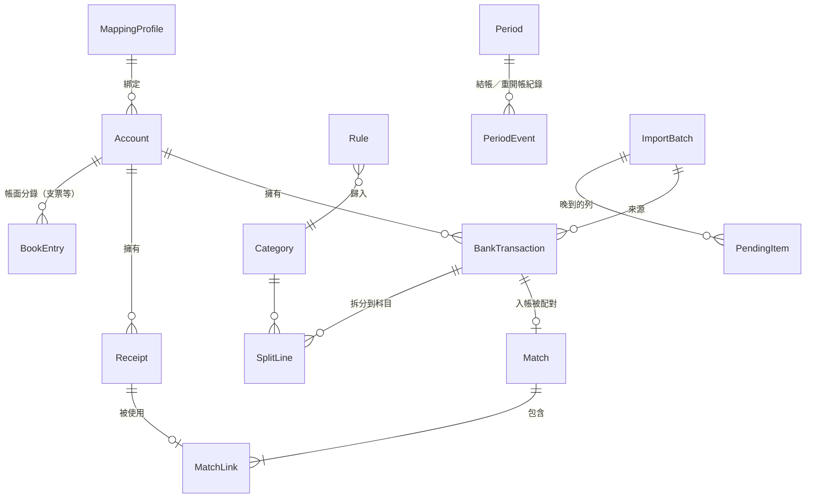

# 第 1 章　需求分析與領域模型

> 寫程式之前最貴的錯誤，是把需求理解錯。這一章示範如何把一份口語化的需求，整理成實體、規則和「必須先問清楚的問題」。

## 1.1 客戶的問題

一間三人烘焙坊，老闆娘每月底要把兩家銀行的對帳單、刷卡機撥款通知、自己開的收款單，用 Excel 一筆一筆對，常常差幾塊錢找一整晚。她要的是：

1. 匯入對帳單（兩家銀行格式不同）。
2. 自動把銀行「入帳」和自己開的「收款單」配起來，標出對不上的。
3. 月底產出能交給會計師的**銀行餘額調節表**。
4. 結帳後那個月不能再被改。

## 1.2 名詞先講清楚

領域名詞是整個系統的共同語言。程式碼、畫面、文件都用同一套詞，才不會在溝通中走樣。

| 中文 | 程式中的名稱 | 意思 |
|---|---|---|
| 對帳單 | statement | 銀行匯出的 CSV，一列一筆銀行交易 |
| 銀行交易 | `BankTransaction` | 金額 > 0 是**入帳**（deposit），< 0 是**支出** |
| 收款單 | `Receipt` | 店家自己開的單據（客戶、單號、金額），代表「帳面上記了一筆收入」 |
| 配對 | `Match` / `MatchLink` | 一筆入帳對應一或多張收款單 |
| 映射設定檔 | `MappingProfile` | 描述某家銀行 CSV 長什麼樣子（編碼、欄位、日期格式、金額寫法） |
| 帳面餘額 | book balance | 程式內「已確認」的收支加期初餘額 |
| 銀行餘額 | bank balance | 對帳單上的餘額 |
| 在途存款 | deposits in transit | 帳面已記（開了收款單），銀行還沒入帳 |
| 未兌現項目 | outstanding items | 帳面已付（例如開出支票），銀行還沒扣款 |
| 結帳 | period close | 把某個月鎖住，之後不能修改 |
| 待處理 | pending item | 匯入時日期落在已結帳月份的交易，等使用者決定怎麼處理 |

**為什麼需要調節表？** 銀行和帳面看的是同一筆錢，但記錄的時間點不同：客戶 3/31 刷卡，收單銀行 4/2 才撥款。3 月底帳面已經有這筆收入，銀行卻還沒有。調節表的工作就是把這些「時間差」逐項列出，證明兩邊其實是一致的。

## 1.3 從需求抽出實體

讀需求時，把名詞圈起來，問「它有沒有自己的生命週期？」有的就是實體（entity）：



每個實體在程式裡都是一個不可變的 `record`，例如銀行交易（`src/LedgerMatch.Core/Domain/Entities.cs`）：

```csharp
/// <summary>A bank statement line. Positive amount = deposit (入帳), negative = withdrawal (支出).</summary>
public sealed record BankTransaction(
    long Id,
    long AccountId,
    DateOnly TxnDate,
    YearMonth PostingPeriod,
    Money Amount,
    string Description,
    string? Serial,
    string? Note,
    string DedupKey,
    long? ImportBatchId,
    int? SourceLine,
    long? CategoryId,
    ClassificationSource ClassifiedBy,
    bool BookConfirmed) : IEntity, IPeriodLocked
```

注意兩個設計細節：

- `TxnDate`（交易日）和 `PostingPeriod`（入帳月份）分開存。平常兩者同月；但晚到的交易若原本的月份已結帳，就會「保留原日期、改列入下一個未結月份」。如果只有一個日期欄位，這個需求就做不到。
- `SourceLine`（來源行號）和 `ImportBatchId`：任何一筆資料都能追溯到「哪個檔案的第幾行」。這對會計系統很重要，出問題時要能回頭查。

## 1.4 從需求抽出規則

把需求裡的「必須」「不得」全部列出來，每一條都會變成至少一個測試：

| 需求原文（摘要） | 規則 | 在哪裡實作 |
|---|---|---|
| 同一檔案重複匯入不產生新交易 | 匯入冪等 | `ImportPlanner`（第 7 章） |
| 重疊檔案不重複；同日同額同摘要的多筆要保留 | 去重不能只看內容 | 同上 |
| 匯入順序不同，結果必須相同 | 與順序無關 | 同上，由性質測試證明 |
| 一對多配對要有搜尋上限，多解時結果決定性 | 有界、決定性搜尋 | `MatchingEngine`（第 8 章） |
| 手續費差額另立分錄，不得吞掉 | 金額守恆 | `Match.Fee` |
| 拆分精確到分，總和恆等於原金額 | 最大餘數法 | `Allocation`（第 9 章） |
| 復原至少 30 層，一次批次算一步 | 操作即 ChangeSet | `UndoRedoService`（第 5 章） |
| 結帳後 UI 與核心都要擋 | 雙層防護 | `PeriodGuard` + 資料庫觸發器 |
| 稽核紀錄只能新增，應用程式內無法修改 | append-only | 觸發器 + 雜湊鏈（第 6 章） |
| 金額不得使用 double／float | 整數「分」 | `Money`（第 4 章） |

## 1.5 找出規格裡的矛盾：先問，不要猜

仔細讀需求，會發現有幾處說不清楚，甚至自相矛盾。這時候正確的做法是**列成問題、附上建議、請客戶決定**，而不是自己默默挑一個。開發前整理出的 8 個問題記錄在 [architecture.md §8](../architecture.md)，以下是最有教學價值的幾個。

### 問題一：調節表公式的符號是反的

需求寫：「期末帳面餘額，加上在途存款，減去未兌現項目，應等於銀行對帳單的期末餘額」。

但同一份需求把在途存款定義為「已入帳於帳面、但銀行尚未入帳」。照這個定義，在途存款是**帳面有、銀行沒有**的錢，應該加在**銀行**那一側才對：

```
帳面 + 在途 − 未兌現 = 銀行      ← 需求原文（符號錯）
銀行 + 在途 − 未兌現 = 帳面      ← 依定義推導
```

最後採用會計師常用的**雙邊格式**：兩邊各自調整，再比較是否相等。這樣不會有符號爭議，而且每一側都列出原因（第 10 章）。

```
調整後銀行餘額 = 銀行期末餘額 + 在途存款 + 其他帳面已記銀行未記 − 未兌現項目
調整後帳面餘額 = 帳面期末餘額 + 銀行已收帳面未記 − 銀行已付帳面未記
```

### 問題二：「或」到底接在哪裡？

需求：「精確配對：金額相同、日期差在設定天數以內，**或**單據編號出現在摘要中。」可以讀成：

- (a)（金額相同 且 日期差內）或 單號在摘要中
- (b) 金額相同 且（日期差內 或 單號在摘要中）

照 (a)，一筆金額不同但摘要含單號的入帳會被**自動確認**。這很危險：金額不同通常代表扣了手續費，應該交給第三階段當成「建議」，由人確認。所以採用 (b)。

### 問題三：收款單屬於哪個帳戶？

調節表是「每個帳戶」各做一份，而在途存款是「還沒進銀行的收款單」，所以必須知道它預期進哪個帳戶。決定：收款單有 `AccountId`。

### 問題四：結帳是全域還是每帳戶？

決定採**全域月份**：結帳 3 月，就是所有帳戶的 3 月都鎖住。實作簡單，也符合小店家「月底一起結」的習慣。

> **心得**：這些問題如果在寫完程式後才發現，修改成本是開發前的好幾倍。開發前花一小時列問題，是整個專案報酬率最高的一小時。

## 1.6 需求會在開發中繼續被澄清

即使開發前問得很仔細，有些問題還是要等到寫測試時才會浮現。本專案就有一個例子：

> 一筆 3/31 的入帳，已確認配對到 3/29 和 4/2 兩張收款單。3 月的調節表該怎麼算？

這個情境是在第 10 章的「獨立現金模型」性質測試中被發現的。原本的程式要求「所有收款單都在月底前開立」，配對才算生效，結果把已經收到錢的收款單誤列為在途存款。修正前同樣先請使用者決定會計定義（採「入帳月認列」），再動手改程式。

## 練習

1. 在 `samples/` 找出兩家銀行的對帳單，比較它們的差異（編碼、日期、金額欄），想想映射設定檔需要哪些欄位才能描述這兩種格式。對照 `src/LedgerMatch.Core/Importing/MappingProfile.cs` 看你的答案。
2. 假設採用問題二的解讀 (a)，在 `tests/LedgerMatch.Core.Tests/Matching/MatchingEngineTests.cs` 寫一個測試，描述「金額不同但摘要含單號」時會發生什麼不好的事。
3. 如果結帳改成「每帳戶每月」，哪些資料表與程式需要修改？（提示：`period` 表、`PeriodGuard`、`IPeriodLocked`）
