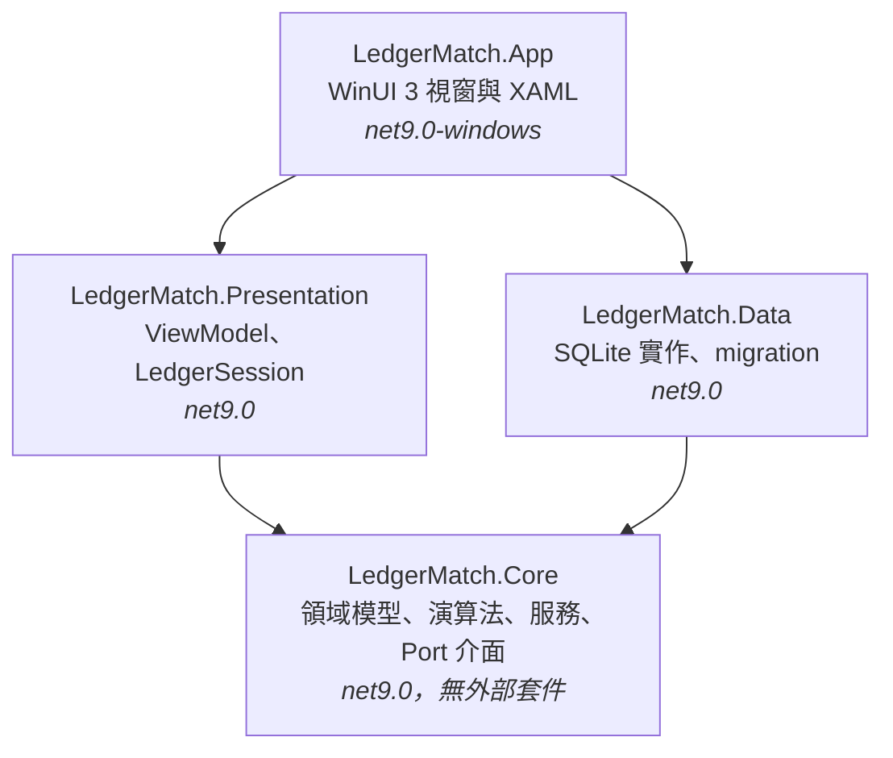
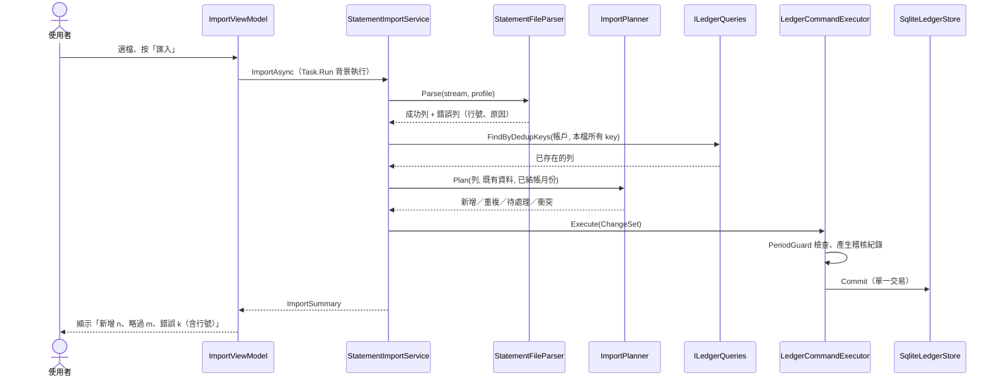

# 第 2 章　系統架構

> 架構的目的不是畫漂亮的圖，而是讓「容易出錯的東西」被隔離在容易測試的地方。

## 2.1 四個專案，一個方向



| 專案 | 放什麼 | 不准放什麼 |
|---|---|---|
| **Core** | 實體、匯入解析、冪等規劃、配對引擎、拆分、規則、結帳、稽核雜湊、調節表計算與匯出、應用服務 | 任何 UI、任何資料庫 API |
| **Data** | `SqliteLedgerStore`、`LedgerDatabase`（開檔與升級）、SQL migration、表格對應 | 商業規則 |
| **Presentation** | ViewModel、`LedgerSession`、對話框與檔案服務的**介面** | WinUI 型別 |
| **App** | XAML 頁面、視窗、對話框與檔案挑選器的 WinUI 實作 | 商業邏輯（code-behind 只做畫面接線） |

依賴只有一個方向：**外層依賴內層，Core 誰都不依賴**。這是題目的硬性要求（「核心邏輯放在獨立的 Class Library，不引用 WinUI」），但即使題目沒要求也該這樣做，理由是：

1. **可測試**：Core 和 Presentation 都是純 `net9.0`，測試不需要啟動視窗，也不綁定 Windows（CI 用 Windows runner 是因為要一併建置與發佈 App）。本專案 338 個測試中，沒有一個需要 WinUI。
2. **可替換**：若哪天要做網頁版，Core 與 Data 可以原封不動重用。
3. **錯誤被隔離**：最容易出錯的是演算法（配對、分配、冪等），它們都在 Core，而且大多是**純函式**，輸入相同、輸出就相同。

測試專案也照同樣的切法：

| 測試專案 | 測什麼 | 需要資料庫嗎 |
|---|---|---|
| Core.Tests | 純演算法、解析、ChangeSet、調節表計算 | 不需要 |
| Data.Tests | SQLite 實作、migration、服務 + 真資料庫的端到端情境 | 需要（暫存檔） |
| Presentation.Tests | 每個 ViewModel，用假的對話框與檔案服務 | 需要（暫存檔） |
| Perf.Tests | 十萬筆資料庫的效能上限 | 需要 |

## 2.2 Port：Core 怎麼存取資料卻不依賴資料庫？

Core 需要讀寫資料，但又不能引用 SQLite。解法是在 Core 定義**介面（port）**，由 Data 實作（adapter）。這就是依賴反轉（Dependency Inversion）。

寫入只有一個入口 `ILedgerStore`（`src/LedgerMatch.Core/Persistence/ILedgerStore.cs`）：

```csharp
public interface ILedgerStore
{
    /// <summary>Reserves <paramref name="count"/> unique ids and returns the first; ids are never reused.</summary>
    long ReserveIds(int count);

    IReadOnlySet<YearMonth> GetClosedPeriods();

    /// <summary>
    /// Applies all changes and appends the audit entries in one transaction.
    /// Updates and deletes only succeed when the stored row still equals the Before image;
    /// otherwise <see cref="ConcurrencyConflictException"/> is thrown and nothing is written.
    /// </summary>
    void Commit(ChangeSet changes, IReadOnlyList<PendingAuditEntry> audit);

    IReadOnlyList<AuditEntry> GetAuditEntries(long afterSequence, int take);
}
```

讀取則是另一個介面 `ILedgerQueries`，提供各種查詢（`GetUnmatchedDeposits`、`FindTransactions`、`GetReconciliationData`…）。讀寫分成兩個介面的理由：

- **寫入面要窄**。全系統只有 `Commit` 一個方法能改資料，所以「每個修改都有稽核、都檢查結帳」可以在一個地方保證（第 5 章）。
- **讀取面可以寬**。查詢多半是為了某個畫面或某個演算法量身打造，數量多但無副作用。

`SqliteLedgerStore` 一個類別同時實作兩個介面，用 C# `partial class` 依主題拆成多個檔案（`SqliteLedgerStore.cs`、`.Queries.cs`、`.Classification.cs`、`.Periods.cs`、`.Books.cs`），避免單一檔案過長。

## 2.3 應用服務：一個使用情境一個方法

Core 裡的服務（`StatementImportService`、`MatchingService`、`PeriodService`…）負責把演算法和資料存取串起來。它們的形狀都很像：

1. 用 `ILedgerQueries` 讀出需要的資料。
2. 呼叫**純演算法**（例如 `MatchingEngine.Run`）算出結果。
3. 把結果包成一個 `ChangeSet`。
4. 交給 `UndoRedoService.Execute`（可復原的操作）或 `LedgerCommandExecutor.Execute`（不可復原的操作，例如匯入、結帳）。

以自動配對為例（`src/LedgerMatch.Core/Matching/MatchingService.cs`，節錄）：

```csharp
public MatchingRunSummary Run(long accountId, YearMonth period, IProgress<MatchingProgress>? progress = null, CancellationToken cancellationToken = default)
{
    var account = queries.GetAccount(accountId) ?? throw new LedgerException($"找不到帳戶 #{accountId}。");
    PeriodGuard.EnsureOpen(period, store.GetClosedPeriods(), $"{account.Name} 的配對");
    var config = settings.GetMatchingSettings();

    var deposits = queries.GetUnmatchedDeposits(accountId, period);                        // 1. 讀
    var receipts = queries.GetUnmatchedReceipts(accountId, DateOnly.MinValue, period.LastDay.AddDays(config.ExactDateToleranceDays));

    var result = MatchingEngine.Run(/* 純函式，不碰資料庫 */ ...);                         // 2. 算
    cancellationToken.ThrowIfCancellationRequested();

    var changes = new ChangeSetBuilder($"自動配對 {account.Name} {period}");               // 3. 包
    // ... 每個提案變成一筆 Match 與數筆 MatchLink ...

    history.Execute(changes.Build());                                                      // 4. 寫（一個復原步驟）
    ...
}
```

這個形狀帶來一個重要性質：**取消一定不留半套結果**。演算法在記憶體中算完才一次寫入；在寫入之前取消，資料庫完全沒被碰過。需求要求「取消後不得留下半套結果」，這裡不需要任何補償邏輯就自然滿足了。

## 2.4 一次匯入的完整旅程



注意 `ImportPlanner` 是純函式：它拿到「檔案內容」和「資料庫裡已有什麼」，回傳分類結果，本身完全不知道資料庫存在。所以冪等的所有規則都能用記憶體中的資料測試，包括第 7 章那個跑 600 組隨機案例的性質測試。

## 2.5 組合根：在哪裡把東西接起來？

物件要有人負責 `new`。本專案的組合根（composition root）有兩層：

**App 啟動**（`src/LedgerMatch.App/App.xaml.cs`）：決定資料庫路徑、開檔、建立 store 與 session。開檔失敗時改開一個說明視窗，而不是讓程式崩潰：

```csharp
protected override void OnLaunched(LaunchActivatedEventArgs args)
{
    var path = Environment.GetEnvironmentVariable("LEDGERMATCH_DB") is { Length: > 0 } custom ? custom : LedgerDatabase.DefaultPath;
    try
    {
        var database = LedgerDatabase.Open(path);
        var store = new SqliteLedgerStore(database);
        var session = new LedgerSession(store, store, TimeProvider.System);
        var window = new MainWindow();
        window.Initialize(session, new FileService());
        _window = window;
    }
    catch (DatabaseOpenException ex)
    {
        _window = new StartupErrorWindow(ex.Failure == DatabaseOpenFailure.TooNew ? "資料庫版本過新" : "資料庫無法開啟", ex.Message);
    }
    ...
}
```

**`LedgerSession`**（`src/LedgerMatch.Presentation/LedgerSession.cs`）：把所有應用服務組起來，並持有「目前選的帳戶與月份」：

```csharp
public LedgerSession(ILedgerStore store, ILedgerQueries queries, TimeProvider time)
{
    Store = store;
    Queries = queries;
    Time = time;
    Executor = new LedgerCommandExecutor(store, time);
    History = new UndoRedoService(Executor);
    Setup = new SetupService(store, queries, History);
    Statements = new StatementImportService(store, queries, Executor, time);
    Matching = new MatchingService(store, queries, History, Settings);
    Periods = new PeriodService(store, queries, Executor, History, time);
    ...
}
```

這裡刻意用手動 `new`，沒有用 DI 容器：服務只有十幾個、生命週期全部相同（跟著開啟的資料庫走），手動組裝一眼就能看懂依賴關係，建構子參數錯了編譯器會直接報錯。（App 的 csproj 仍引用了 `Microsoft.Extensions.DependencyInjection`，但原始碼沒有使用，是可以清掉的殘留。）

測試時只要換掉這三個參數：`TestApp` 傳入暫存檔的 store 和 `FakeTimeProvider`，整個 session 就在受控的環境中運作（第 11 章）。

## 2.6 架構決策的取捨

| 決策 | 得到 | 付出 |
|---|---|---|
| Core 不依賴任何外部套件 | 演算法可在任何環境測試；沒有套件版本相容問題 | CSV 解析等功能要自己寫（約 150 行） |
| 讀寫分兩個 port | 寫入路徑單一、容易證明不變式 | 介面方法較多 |
| 演算法是純函式 | 可用性質測試、可取消、結果決定性 | 服務層要負責讀資料與組 ChangeSet |
| 一個 store 實作兩個介面 | 部署簡單 | 若要讀寫分離到不同資料庫需再拆 |

## 練習

1. 在 `src/LedgerMatch.Core` 的任一檔案加上 `using Microsoft.Data.Sqlite;`，試著編譯。為什麼會失敗？這個失敗是好事還是壞事？
2. 畫出「確認建議配對」從按鈕到資料庫的序列圖（提示：`MatchingViewModel.ConfirmSelected` → `MatchingService.Confirm` → `UndoRedoService.Execute`）。
3. `ImportPlanner.Plan` 為什麼不直接接收 `ILedgerQueries`，而是接收一個已經查好的 `IReadOnlyDictionary`？兩種寫法各自對測試有什麼影響？
