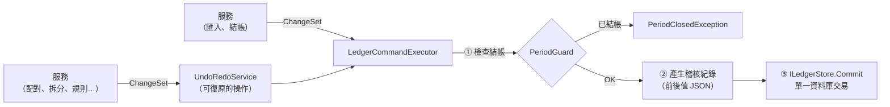

# 第 5 章　寫入路徑：ChangeSet、稽核、復原、結帳

> 本專案最重要的一個設計：**所有修改都走同一條路**。這一條路同時解決了稽核、復原重做、結帳鎖定、原子性四個需求。

## 5.1 問題：四個需求，各自實作會怎樣？

題目對「修改資料」有四個要求：

1. **稽核**：所有修改性操作寫入只能新增的稽核紀錄，含前後值。
2. **復原與重做**：至少 30 層，一次批次操作算一步；復原後統計與餘額同步還原。
3. **結帳鎖定**：已結帳月份的資料不得被修改，核心邏輯要擋。
4. **原子性**：取消或失敗時不能留下半套結果。

如果每個功能（配對、拆分、套用規則、編輯收款單…）各自實作這四件事，就會有十幾個功能 × 四件事 = 幾十處要寫對，而且新增功能時很容易漏掉其中一件。

本專案的解法是把「修改」本身變成一個資料結構：**ChangeSet**。

## 5.2 ChangeSet：把修改變成資料

一個 ChangeSet 是「一個使用者操作」造成的所有逐列變更，每一筆都帶完整的前值與後值（`src/LedgerMatch.Core/Persistence/ChangeSet.cs`）：

```csharp
/// <summary>A row-level change with full before/after images. Insert has no Before, Delete has no After.</summary>
public sealed record EntityChange
{
    public IEntity? Before { get; }
    public IEntity? After { get; }

    public ChangeKind Kind => (Before, After) switch
    {
        (null, _) => ChangeKind.Insert,
        (_, null) => ChangeKind.Delete,
        _ => ChangeKind.Update,
    };

    public EntityChange Invert() => new(After, Before);
}

/// <summary>
/// One user-visible operation (possibly a batch). It is committed atomically, written to the audit log,
/// and is the unit of undo/redo.
/// </summary>
public sealed record ChangeSet(string Operation, IReadOnlyList<EntityChange> Changes)
{
    /// <summary>Reverses every change, in reverse order, so dependent rows are removed before their parents.</summary>
    public ChangeSet Invert(string operation) =>
        new(operation, Changes.Reverse().Select(c => c.Invert()).ToList());
}
```

**反轉（Invert）是整個設計的關鍵**：

| 原操作 | 前值 | 後值 | 反轉後 |
|---|---|---|---|
| Insert | 無 | 新列 | Delete 該列 |
| Update | 舊列 | 新列 | Update 回舊列 |
| Delete | 舊列 | 無 | Insert 回舊列 |

因為每個變更都有完整的前後值，**任何操作的復原都可以自動產生**，不需要為每個功能手寫「反向操作」。反轉時順序也要倒過來：配對時先插入 `Match` 再插入 `MatchLink`；復原時必須先刪 `MatchLink` 再刪 `Match`，否則會違反外鍵。

服務端用 `ChangeSetBuilder` 組裝，例如確認建議配對：

```csharp
public int Confirm(IEnumerable<long> matchIds)
{
    var matches = Load(matchIds).Where(m => m.Confidence == MatchConfidence.Suggested).ToList();
    var changes = new ChangeSetBuilder($"確認配對（{matches.Count} 筆）");
    foreach (var m in matches)
    {
        changes.Update(m, m with { Confidence = MatchConfidence.Confirmed });
    }

    history.Execute(changes.Build());
    return matches.Count;
}
```

不管勾選了 1 筆還是 200 筆，都是**一個** ChangeSet，所以也是**一個**復原步驟，正好符合「一次批次操作算一步」。

## 5.3 LedgerCommandExecutor：唯一的寫入關卡

所有 ChangeSet 都經過 `LedgerCommandExecutor`（`src/LedgerMatch.Core/Persistence/LedgerCommandExecutor.cs`）：

```csharp
/// <summary>
/// The single path for every modifying operation: enforces closed periods, builds the audit trail
/// and commits atomically.
/// </summary>
public sealed class LedgerCommandExecutor(ILedgerStore store, TimeProvider time)
{
    public void Execute(ChangeSet changeSet)
    {
        if (changeSet.IsEmpty)
        {
            return;
        }

        PeriodGuard.EnsureWritable(changeSet, store.GetClosedPeriods());     // ① 結帳檢查

        var at = time.GetUtcNow();
        var audit = changeSet.Changes                                         // ② 每個變更一筆稽核
            .Select(c => new PendingAuditEntry(
                at,
                changeSet.Operation,
                c.EntityType.Name,
                c.EntityId,
                c.Kind.ToString(),
                c.Before is null ? null : LedgerJson.Serialize(c.Before),
                c.After is null ? null : LedgerJson.Serialize(c.After)))
            .ToList();

        store.Commit(changeSet, audit);                                       // ③ 資料與稽核同一個交易
    }
}
```



四個需求在這裡一次滿足：

| 需求 | 在哪裡滿足 |
|---|---|
| 稽核含前後值 | ②：直接把 `Before`／`After` 序列化成 JSON |
| 稽核不會漏 | 沒有其他寫入路徑；`ILedgerStore` 只有 `Commit` 一個寫入方法 |
| 結帳鎖定 | ①：檢查每個變更的前值**和**後值所屬月份 |
| 原子性 | ③：資料變更與稽核在同一個 SQLite 交易，要嘛全寫、要嘛全不寫 |

## 5.4 PeriodGuard：前值和後值都要檢查

會被結帳鎖住的實體實作 `IPeriodLocked`：

```csharp
/// <summary>An entity that belongs to an accounting month and becomes read-only once that month is closed.</summary>
public interface IPeriodLocked
{
    YearMonth LockPeriod { get; }
}
```

`BankTransaction` 的 `LockPeriod` 是入帳月份；收款單是開立月份；配對是入帳的月份。`PeriodGuard` 對每個變更的前值與後值都檢查一次：

```csharp
foreach (var change in changeSet.Changes)
{
    EnsureOpen(change.Before, closedPeriods);
    EnsureOpen(change.After, closedPeriods);
}
```

為什麼兩個都要查？想像把一張 3 月的收款單日期改成 4 月：後值在 4 月（未結帳），但前值在 3 月（已結帳）。只查後值的話，已結帳的 3 月就少了一張收款單，帳就被改了。

**第二道防線**：資料庫本身也有觸發器，即使有人繞過應用層直接寫 SQL，也會被拒絕（第 6 章）。這種「應用層先擋、資料庫再擋」的做法叫縱深防禦（defense in depth）。

## 5.5 UndoRedoService：復原就是執行反轉的 ChangeSet

```csharp
public void Undo()
{
    lock (_gate)
    {
        var step = _undo.Last?.Value ?? throw new InvalidOperationException("沒有可以復原的操作。");
        _executor.Execute(step.Invert($"復原：{step.Operation}"));
        _undo.RemoveLast();
        _redo.Push(step);
    }

    Changed?.Invoke(this, EventArgs.Empty);
}
```

這幾行有很多值得注意的地方：

- **復原也走 `_executor`**。所以復原本身會被稽核（稽核紀錄裡看得到「復原：確認配對（3 筆）」），也會被結帳檢查擋下。不能透過復原去改已結帳的月份。
- **先執行、成功後才移動堆疊**。如果 `Execute` 丟出例外（例如月份已結帳），`_undo` 和 `_redo` 都保持原狀，使用者可以修正問題後再試。
- **重做不需要另外存資料**：重做就是把原本的 ChangeSet 再執行一次（`step with { Operation = $"重做：{step.Operation}" }`）。
- **容量 50 層**（最少 30，建構子會檢查）。超過時丟掉最舊的一步，用 `LinkedList` 而不是 `Stack` 就是為了能從底部移除。
- **`lock`**：自動配對在背景執行緒執行，使用者可能同時在 UI 執行緒按「復原」。鎖保證兩個步驟不會交錯。

### 復原時資料已經被改過怎麼辦？

情境：步驟 A 新增了一筆交易；之後某個**不進復原堆疊**的操作（直接走 executor）修改了同一筆交易的備註。這時復原 A 要刪除那筆交易，但它已經不是 A 當初寫入的樣子了，直接刪掉會連帶丟失後來的修改。

解法是**樂觀並行控制**：復原產生的 Update／Delete 帶著「我認為資料庫目前的樣子」（也就是原操作的後值），資料層用 `WHERE 每一欄 IS 預期值` 去更新或刪除。若影響列數不是 1，代表資料已經被改過，就丟出 `ConcurrencyConflictException`，整個交易回滾（第 6 章）。測試 `UndoRedoServiceTests.Undo_AfterRowChangedOutsideHistory_IsConflict` 驗證的正是這個情境：

```csharp
var t = Txn(1);
_history.Execute(new ChangeSetBuilder("a").Insert(t).Build());
new LedgerCommandExecutor(_store, TimeProvider.System).Execute(new ChangeSetBuilder("外部").Update(t, t with { Note = "x" }).Build());

Assert.Throws<ConcurrencyConflictException>(() => _history.Undo());
```

## 5.6 哪些操作「刻意」不能復原？

| 操作 | 為什麼不做成復原步驟 | 怎麼補救 |
|---|---|---|
| 匯入對帳單 | 匯入是冪等的，「重來」本來就安全；一次匯入可能有數千列，放進復原堆疊沒有實際意義 | 稽核紀錄完整保留 |
| 結帳 | 結帳是一種「承諾」，不該被一個 Ctrl+Z 撤銷 | 必須走「重新開帳」並輸入理由 |
| 重新開帳 | 同上，且需求明訂必須輸入理由 | 稽核紀錄記下理由 |

`PeriodService.Reopen` 直接呼叫 `executor.Execute`，而不是 `history.Execute`：

```csharp
public void Reopen(YearMonth month, string reason)
{
    if (string.IsNullOrWhiteSpace(reason))
    {
        throw new LedgerException("重新開帳必須輸入理由。");
    }
    ...
    executor.Execute(new ChangeSetBuilder($"重新開帳 {month}：{reason.Trim()}")
        .Update(existing, existing with { IsClosed = false, ClosedAt = null })
        .Insert(new PeriodEvent(store.ReserveIds(1), month, PeriodAction.Reopen, reason.Trim(), now))
        .Build());
}
```

## 5.7 Id 為什麼要先「預約」？

```csharp
var nextId = result.Proposals.Count == 0 ? 0 : store.ReserveIds(result.Proposals.Count + linkCount);
```

一般做法是讓資料庫在 INSERT 時自動產生 id。但這裡不行：

1. **ChangeSet 在寫入前就要完整**：`MatchLink` 要記錄它屬於哪個 `Match`，所以 `Match` 的 id 必須在寫入前就知道。
2. **復原後重做要用同一個 id**：重做是重新執行同一個 ChangeSet，id 必須寫死在裡面。如果交給資料庫自動編號，重做時 id 就會變，稽核紀錄就對不上了。

所以 id 由一張 `id_sequence` 表統一發放，一次可預約多個，**永不重複使用**：

```csharp
public long ReserveIds(int count)
{
    using var connection = database.OpenConnection();
    using var command = connection.Command(
        "UPDATE id_sequence SET next_id = next_id + @n WHERE name = 'global' RETURNING next_id - @n;", ("@n", count));
    return (long)command.ExecuteScalar()!;
}
```

## 5.8 這個設計的代價

沒有免費的設計。ChangeSet 的代價：

- **每次修改前要先讀出前值**。一般的 `UPDATE ... SET category_id = 5 WHERE id IN (...)` 不行，要先把那些列讀出來、產生新物件，再逐列更新。
- **大量寫入有額外成本**。匯入 5,000 列就是 5,000 個 EntityChange 加 5,000 筆稽核紀錄（各自計算 SHA-256 雜湊）。在十萬筆資料庫上實測仍只要約 0.2 秒（第 12 章），但這是設計時有意識接受的取捨。

換來的是：新增任何功能時，只要它產生 ChangeSet，就**自動**具備稽核、復原、結帳保護與原子性，而且這件事可以集中測試證明。`AuditTrailTests` 有四個測試：

- `EveryModifyingOperation_IsAuditedWithBeforeAndAfter`：逐一執行每種修改操作，檢查都有前後值。
- `NoPublicApi_CanModifyOrDeleteAuditEntries`：用反射確認沒有任何公開 API 能改或刪稽核紀錄。
- `DataLayerSource_NeverUpdatesOrDeletesAuditLog`：掃描 `src` 下所有 .cs 與 .sql 原始檔，確認沒有對 `audit_log` 的 UPDATE／DELETE 語句。
- `AuditLog_SurvivesRestartAndStillVerifies`：重開資料庫後雜湊鏈仍能驗證。

## 練習

1. 在 `UndoRedoService.Undo` 中把 `_executor.Execute(...)` 和 `_undo.RemoveLast()` 的順序對調，哪個測試會失敗？為什麼原本的順序比較安全？
2. `ChangeSet.Invert` 為什麼要 `Reverse()`？試著拿掉，執行 `tests/LedgerMatch.Data.Tests/History/UndoRedoIntegrationTests.cs`，觀察失敗訊息。
3. 設計題：如果要讓「匯入」也能復原，需要改哪些地方？會遇到什麼問題？（提示：待處理佇列、`ReserveIds`、復原堆疊容量）
