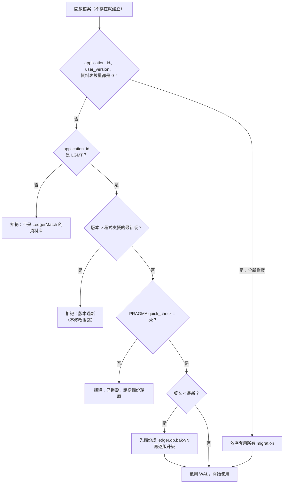
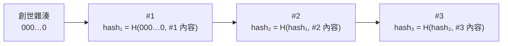

# 第 6 章　資料層：SQLite 實作

> 本機資料庫的難處不在 SQL，而在於「使用者的檔案會活得比你的程式版本還久」。

## 6.1 開檔：先檢查，再信任

使用者可能拿一個新版程式建立的資料庫，用舊版程式開；也可能硬碟壞軌、檔案被其他程式覆寫。`LedgerDatabase.Open`（`src/LedgerMatch.Data/LedgerDatabase.cs`）開檔時依序檢查：



幾個關鍵技巧：

**用 `application_id` 標記檔案身分**。SQLite 檔頭有一個 32 位元欄位可以自由使用，本專案寫入 `0x4C474D54`（ASCII 的 "LGMT"）。這樣就能分辨「空的新檔」、「我的資料庫」和「別的程式的 SQLite 檔」：

```csharp
/// <summary>"LGMT" — marks the file as a LedgerMatch database.</summary>
public const int ApplicationId = 0x4C474D54;
```

**用 `user_version` 記錄 schema 版本**。同樣是檔頭欄位，不需要另外建一張版本表。

**版本過新時絕不修改檔案**。舊程式不知道新版 schema 長什麼樣子，任何寫入都可能毀掉資料。錯誤訊息明講「程式不會修改這個檔案」，讓使用者放心。測試 `TooNewDatabase_IsRejectedWithClearMessage_AndLeftUntouched` 會比對開啟前後的檔案位元組完全相同。

**損毀偵測**。兩層：SQLite 開檔時的錯誤碼（11 = `SQLITE_CORRUPT`、26 = `SQLITE_NOTADB`），加上 `PRAGMA quick_check`。測試用兩種方式製造損毀：整個檔案填亂碼，以及只翻轉資料頁中的位元。

## 6.2 Migration：嵌入的 SQL 檔

Schema 變更寫成 SQL 檔，命名 `V001__initial_schema.sql`、`V002__book_entries.sql`，以 Embedded Resource 編進組件。程式啟動時用正規表達式找出所有 migration，並檢查版本號必須從 1 開始連續：

```csharp
[GeneratedRegex(@"\.V(\d{3})__(\w+)\.sql$")]
private static partial Regex MigrationName();
```

每個 migration 在**自己的交易**裡執行，且在同一個交易中更新 `user_version`：

```csharp
private static void Apply(SqliteConnection connection, Migration migration)
{
    using var tx = connection.BeginTransaction();
    using (var command = connection.CreateCommand())
    {
        command.Transaction = tx;
        command.CommandText = migration.Sql;
        command.ExecuteNonQuery();
        command.CommandText = $"PRAGMA application_id = {ApplicationId}; PRAGMA user_version = {migration.Version};";
        command.ExecuteNonQuery();
    }

    tx.Commit();
}
```

如果 V3 執行到一半失敗，V3 整個回滾，`user_version` 仍是 2，下次開啟會重試 V3。測試 `FailingMigration_RollsBackThatVersion` 驗證這點。

**升級前先備份**：用 SQLite 的 Online Backup API（`connection.BackupDatabase`）複製成 `ledger.db.bak-v1`。即使 migration 本身有 bug，使用者的資料也還在。

本專案實際經歷了一次升級：V002 新增帳面分錄與對帳單期末餘額兩張表。測試 `RealVersionOneDatabase_UpgradesToLatestKeepingData` 用**真正的 V001** 建庫、寫入資料，再用目前的程式開啟，確認資料保留、新表存在、備份檔產生。

## 6.3 資料庫是第二道防線：觸發器

應用層的 `PeriodGuard` 已經會擋下修改已結帳月份的操作（第 5 章）。資料庫再用觸發器擋一次（`V001__initial_schema.sql`）：

```sql
-- Second line of defence for closed periods (the application checks first).
CREATE TRIGGER trg_bank_txn_closed_upd BEFORE UPDATE ON bank_txn
WHEN EXISTS (SELECT 1 FROM period WHERE month IN (OLD.posting_period, NEW.posting_period) AND is_closed = 1)
BEGIN SELECT RAISE(ABORT, 'PERIOD_CLOSED'); END;
```

注意 `OLD.posting_period, NEW.posting_period` 兩個都查，與應用層「前值後值都檢查」的邏輯一致。

稽核紀錄則是**完全不可改**：

```sql
-- Audit log is append-only.
CREATE TRIGGER trg_audit_no_update BEFORE UPDATE ON audit_log
BEGIN SELECT RAISE(ABORT, 'AUDIT_APPEND_ONLY'); END;
CREATE TRIGGER trg_audit_no_delete BEFORE DELETE ON audit_log
BEGIN SELECT RAISE(ABORT, 'AUDIT_APPEND_ONLY'); END;
```

store 的 `Commit` 把觸發器的錯誤翻譯成使用者看得懂的例外：

```csharp
catch (SqliteException ex) when (ex.Message.Contains("PERIOD_CLOSED", StringComparison.Ordinal))
{
    throw new LedgerException("資料庫拒絕修改已結帳月份的資料。", ex);
}
catch (SqliteException ex) when (ex.SqliteErrorCode == SqliteConstraint)
{
    throw new ConcurrencyConflictException($"資料與目前狀態衝突，這次修改沒有寫入（{ex.Message}）。", ex);
}
```

> **已知缺口**：外部 code review 指出 `statement_balance` 沒有 DELETE 觸發器、`match_link` 沒有 UPDATE 觸發器。這兩種情況應用層都已經擋下，所以不影響正確性，但第二道防線不完整。補上的方法是新增一個 V003 migration，這是很好的練習題（見本章練習 3）。

## 6.4 雜湊鏈：讓竄改可以被發現

觸發器只能防止「透過這個程式」修改稽核紀錄。有人用外部 SQLite 工具先刪掉觸發器，就能改資料。完全防止做不到，但可以讓竄改**被發現**：每筆稽核紀錄的雜湊包含前一筆的雜湊（`src/LedgerMatch.Core/Persistence/Audit.cs`）：

```csharp
public static string Compute(string prevHash, long sequence, PendingAuditEntry entry)
{
    var payload = string.Join(
        '\u001f',
        prevHash,
        sequence.ToString(System.Globalization.CultureInfo.InvariantCulture),
        entry.At.ToString("O", System.Globalization.CultureInfo.InvariantCulture),
        entry.Operation,
        entry.EntityType,
        entry.EntityId.ToString(System.Globalization.CultureInfo.InvariantCulture),
        entry.Action,
        entry.BeforeJson ?? string.Empty,
        entry.AfterJson ?? string.Empty);
    return Convert.ToHexString(SHA256.HashData(Encoding.UTF8.GetBytes(payload)));
}
```



改了第 2 筆的內容，`hash₂` 就對不上；如果連 `hash₂` 也重算，第 3 筆記錄的 `prev_hash` 又對不上。要不被發現，就得重算之後的每一筆。`FindFirstBrokenLink` 會指出第一筆不一致的序號，稽核頁面可以直接執行驗證。

兩個實作細節：

- **欄位分隔符用 `\u001f`**（ASCII Unit Separator）而不是逗號。如果用逗號，「操作=`a,b`、類型=`c`」和「操作=`a`、類型=`b,c`」會串出同一個字串、得到同一個雜湊。用一個資料中不會出現的字元就沒有這種歧義。
- **時間用 `"O"` 格式**（ISO 8601 round-trip），確保寫入與驗證時字串完全相同，不受地區設定影響。

## 6.5 TableMap：一個 record 對應一張表

不用 ORM，但也不想每張表都手寫 INSERT/UPDATE/DELETE。`TableMap<T>`（`src/LedgerMatch.Data/Mapping/TableMap.cs`）用「欄位名稱 + 取值函式」的清單，自動產生三種 SQL：

```csharp
private readonly string _updateSql =
    $"UPDATE {table} SET {string.Join(", ", columns.Skip(1).Select((c, i) => $"{c.Name} = @p{i + 1}"))} " +
    $"WHERE {string.Join(" AND ", columns.Select((c, i) => $"{c.Name} IS @b{i}"))};";
```

每張表的定義很直白（`src/LedgerMatch.Data/Mapping/EntityMaps.cs`）：

```csharp
public static readonly TableMap<MatchLink> MatchLink = new(
    "match_link",
    [
        ("id", e => e.Id),
        ("match_id", e => e.MatchId),
        ("receipt_id", e => e.ReceiptId),
        ("period", e => e.Period),
    ],
    r => new MatchLink(r.Long("id"), r.Long("match_id"), r.Long("receipt_id"), r.Month("period")));
```

### 為什麼 WHERE 用 `IS` 而不是 `=`？

UPDATE 和 DELETE 的 WHERE 條件比對**每一個欄位**的前值，這就是第 5 章的樂觀並行。比對時用 `IS` 而不是 `=`，因為在 SQL 裡：

```sql
NULL = NULL   -- 結果是 NULL（視為不成立）
NULL IS NULL  -- 結果是 1（成立）
```

很多欄位可以是 NULL（備註、科目、序號）。如果用 `=`，只要某個欄位是 NULL，WHERE 就永遠不成立，更新就會被誤判為「資料已被改過」。

影響列數不是 1 時丟出例外：

```csharp
private static void EnsureOneRow(int affected, IEntity before)
{
    if (affected != 1)
    {
        throw new ConcurrencyConflictException($"{typeof(T).Name} #{before.Id} 已被其他操作變更或刪除，無法套用這次修改。");
    }
}
```

### 效能：預先編譯的指令

匯入 5,000 列時，如果每一列都重新解析一次 SQL，會慢很多。`CommandCache` 在同一個交易中，每種 SQL 只 `Prepare()` 一次，之後只換參數值：

```csharp
public SqliteCommand Get(string sql, int parameterCount, string prefix, int beforeCount = 0)
{
    if (!_commands.TryGetValue(sql, out var command))
    {
        command = connection.CreateCommand();
        ...
        command.Prepare();
        _commands[sql] = command;
    }

    return command;
}
```

## 6.6 分頁：用游標，不用 OFFSET

交易清單可能有十萬筆，畫面一次只顯示 200 筆，往下捲再載入下一頁。直覺寫法是 `LIMIT 200 OFFSET 4000`，但 OFFSET 要先掃過前 4,000 筆再丟掉，越後面越慢。

本專案用**鍵集分頁（keyset pagination）**：記住上一頁最後一筆的排序鍵 `(txn_date, id)`，下一頁從它之後開始（`SqliteLedgerStore.Classification.cs`）：

```csharp
if (after is not null)
{
    where.Append(" AND (t.txn_date > @cd OR (t.txn_date = @cd AND t.id > @cid))");
    parameters.Add(("@cd", after.Date));
    parameters.Add(("@cid", after.Id));
}
...
"ORDER BY t.txn_date, t.id LIMIT @take;"
```

配合索引 `ix_bank_txn_date ON bank_txn(account_id, txn_date)`，不管翻到第幾頁，查詢時間都差不多。（`id` 是 `INTEGER PRIMARY KEY`，也就是 SQLite 的 rowid，每個索引項目都會自動附帶它，所以 `(txn_date, id)` 的排序可以直接沿著這個索引走。）效能測試在十萬筆資料庫上做關鍵字篩選，計數加兩頁約 40 ms。

排序鍵為什麼要加上 `id`？因為同一天可能有很多筆交易。只用日期當游標的話，同一天的交易如果剛好跨兩頁，就會有幾筆被跳過或重複。加上唯一的 `id` 就成為全序（total order）。

## 6.7 連線與並行

`SqliteLedgerStore` 的每個方法都**自己開一條連線、用完就關**（實際上是從連線池借還，所以很便宜）：

```csharp
/// <summary>SQLite implementation of the ledger ports. Every call opens its own pooled connection, so it is safe from background tasks.</summary>
public sealed partial class SqliteLedgerStore(LedgerDatabase database) : ILedgerStore
```

這讓背景執行緒（配對、匯入）和 UI 執行緒（查詢清單）可以同時使用 store，不會共用同一條連線而互相干擾。資料庫啟用 **WAL 模式**（Write-Ahead Logging），讀取不會被寫入擋住。效能測試驗證了：配對執行期間同時查詢交易清單，最慢的一次查詢約 31 ms。

## 練習

1. 把 `TableMap` 的 `IS` 改成 `=`，執行 Data.Tests。哪些測試失敗？失敗訊息是什麼？
2. 寫一個測試：直接用 `SqliteConnection` 對 `audit_log` 執行 `DELETE`，確認被觸發器拒絕。（提示：參考 `SqliteLedgerStoreTests.AuditLog_RejectsModificationEvenThroughRawSql`）
3. 補上 6.3 提到的缺口：新增 `V003__more_period_triggers.sql`，為 `statement_balance` 加 DELETE 觸發器、為 `match_link` 加 UPDATE 觸發器，並寫測試證明它們有效、舊版資料庫能升級。（提示：`BuiltInMigrations_AreContiguousFromOne` 會檢查版本號連續）
4. 思考題：雜湊鏈能偵測竄改，但無法偵測「把最後幾筆紀錄整個刪掉」。有什麼辦法補強？
