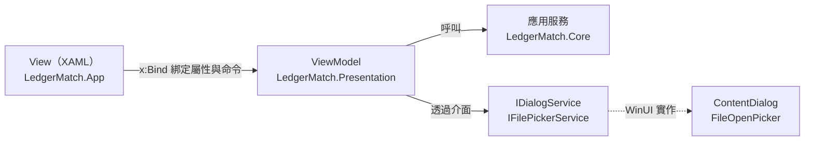

# 第 11 章　展示層：MVVM 與 WinUI 3

> 目標：畫面上能做的每一件事，都能在沒有畫面的情況下測試。

## 11.1 MVVM 的分工



- **View** 只負責排版與綁定。code-behind 只處理純畫面的事情（例如視窗把手、清單捲到底時載入下一頁）。
- **ViewModel** 保存畫面狀態（目前的清單、勾選、進度）、提供命令（按鈕要執行的動作）。它是純 `net9.0`，不引用任何 WinUI 型別。
- **對話框和檔案挑選器**是 WinUI 的東西，ViewModel 不能直接用，所以抽象成介面（`src/LedgerMatch.Presentation/Services/PlatformServices.cs`），由 App 專案實作，測試則換成假的實作。

## 11.2 CommunityToolkit.Mvvm：用 source generator 消除樣板

傳統 MVVM 寫一個可通知的屬性要十幾行（欄位、getter、setter、比較、觸發 `PropertyChanged`）。CommunityToolkit.Mvvm 用 source generator，在編譯時自動產生這些程式碼：

```csharp
public sealed partial class MatchingViewModel : PageViewModel
{
    [ObservableProperty]
    [NotifyCanExecuteChangedFor(nameof(CancelCommand), nameof(RunCommand))]
    private bool isRunning;

    [ObservableProperty]
    private double progressPercent;

    [RelayCommand(CanExecute = nameof(CanRun))]
    private async Task Run() { ... }

    private bool CanRun() => !IsRunning;

    [RelayCommand(CanExecute = nameof(IsRunning))]
    private void Cancel() => _cancellation?.Cancel();
}
```

這段程式碼會產生：

- 公開屬性 `IsRunning`、`ProgressPercent`，值改變時自動觸發 `PropertyChanged`。
- 命令 `RunCommand`（`IAsyncRelayCommand`）、`CancelCommand`。
- `IsRunning` 改變時，自動重新評估兩個命令的 `CanExecute`：執行中「執行」按鈕停用，「取消」按鈕啟用。

類別必須宣告為 `partial`，因為產生的程式碼會成為同一個類別的另一部分。

需要在屬性改變時做額外的事，就實作產生器預留的 `partial` 方法：

```csharp
[ObservableProperty]
private YearMonth currentMonth;

partial void OnCurrentMonthChanged(YearMonth value) => OnPropertyChanged(nameof(IsCurrentMonthClosed));
```

## 11.3 錯誤處理集中在一個地方

所有頁面的 ViewModel 都繼承 `PageViewModel`，用 `RunAsync` 包住每個動作（`src/LedgerMatch.Presentation/ViewModels/PageViewModel.cs`）：

```csharp
protected async Task<bool> RunAsync(Func<Task> action, string errorTitle = "無法完成操作")
{
    try
    {
        IsBusy = true;
        LastError = null;
        await action();
        return true;
    }
    catch (OperationCanceledException)
    {
        StatusMessage = "已取消，資料未變更。";
        return false;
    }
    catch (Exception ex) when (ex is LedgerException or ImportFileException)
    {
        LastError = ex.Message;
        await Dialogs.ShowErrorAsync(errorTitle, ex.Message);
        return false;
    }
    catch (Exception ex)
    {
        LastError = $"{ex.GetType().Name}: {ex.Message}";
        await Dialogs.ShowErrorAsync("發生未預期的錯誤", LastError);
        return false;
    }
    finally
    {
        IsBusy = false;
    }
}
```

三種情況分開處理：

- **取消**：不是錯誤，在狀態列顯示「已取消，資料未變更」。這句話能成立，是因為第 2 章的設計保證了取消時什麼都沒寫入。
- **商業規則錯誤**：訊息本來就是寫給使用者看的，直接顯示。
- **未預期的錯誤**：也要顯示，並附上例外型別，方便回報問題。**絕對不吞掉**。

App 層還有最後一道防線：`Application.UnhandledException` 會把漏網的例外顯示出來，而不是讓程式直接消失。

## 11.4 背景作業：不卡畫面、可取消、有進度

自動配對可能跑好幾秒，不能在 UI 執行緒上跑，否則畫面會凍結。`MatchingViewModel.Run`：

```csharp
_cancellation = new CancellationTokenSource();
IsRunning = true;
try
{
    await RunAsync(async () =>
    {
        var progress = new Progress<MatchingProgress>(p =>
        {
            ProgressPercent = p.Total == 0 ? 0 : (((int)p.Stage - 1) * 100.0 / 3) + (p.Processed * 100.0 / 3 / p.Total);
            ProgressText = $"第 {(int)p.Stage} 階段（{StageName(p.Stage)}）{p.Processed}/{p.Total}";
        });
        var summary = await Session.Matching.RunAsync(account.Id, Session.CurrentMonth, progress, _cancellation.Token);
        ...
    }, "配對失敗");
}
finally
{
    IsRunning = false;
    ...
}
```

三個 .NET 標準工具各司其職：

| 工具 | 作用 |
|---|---|
| `Task.Run`（在 `MatchingService.RunAsync` 內） | 把計算移到執行緒池 |
| `Progress<T>` | 建立時會記住當下的 `SynchronizationContext`（UI 執行緒），所以回呼一定在 UI 執行緒執行，可以安全地更新綁定的屬性 |
| `CancellationToken` | 「取消」按鈕呼叫 `Cancel()`，引擎在下一個檢查點丟出 `OperationCanceledException` |

進度條的換算：三個階段各占 1/3，`(階段 − 1) × 33.3% + 階段內進度 × 33.3%`。

## 11.5 跨執行緒的通知：一個真實的 bug

所有頁面都監聽 `LedgerSession.DataChanged`，資料一變就重新整理。這個事件由 `UndoRedoService.Changed` 觸發，問題在於：**自動配對在背景執行緒寫入**，所以 `Changed` 是在背景執行緒觸發的。接著頁面在背景執行緒修改 `ObservableCollection`，WinUI 就會丟出例外（UI 物件只能在 UI 執行緒修改）。

修正方式是在 `LedgerSession` 建立時記住 UI 執行緒的 `SynchronizationContext`，之後的通知都轉回 UI 執行緒：

```csharp
// Background work (matching, imports) commits on worker threads; listeners update UI-bound collections.
_uiContext = SynchronizationContext.Current;
History.Changed += (_, _) => OnUiThread(NotifyDataChanged);

private void OnUiThread(Action action)
{
    if (_uiContext is null || SynchronizationContext.Current == _uiContext)
    {
        action();
    }
    else
    {
        _uiContext.Post(_ => action(), null);
    }
}
```

`_uiContext is null` 的分支是為了測試：xUnit 的測試執行緒沒有 `SynchronizationContext`，此時直接呼叫即可。

同一次修正也替 `UndoRedoService` 加上 `lock`（第 5 章），因為背景的配對寫入和 UI 的「復原」可能同時發生。

## 11.6 非同步重新載入的競爭：另一個真實的 bug

交易清單的重新載入是非同步的：先算總數，再載入第一頁，兩步都在背景執行。如果一個寫入觸發 `DataChanged`，而上一次重新載入還沒完成，就會有兩個載入同時進行，**後發先至**時清單會出現重複或過時的資料。

修正用一個版本號：每次重新載入時遞增，非同步步驟完成後檢查版本是否還是最新，不是就放棄（`TransactionsViewModel.cs`）：

```csharp
// Reloads can overlap (a write raises DataChanged while a reload is in flight); only the newest may fill the list.
private int _loadVersion;

[RelayCommand]
public Task ReloadAsync() => RunAsync(async () =>
{
    var version = ++_loadVersion;
    ...
    var filter = BuildFilter();
    var count = await Task.Run(() => Session.Queries.CountTransactions(filter));
    if (version != _loadVersion)
    {
        return;      // 已經有更新的載入，這次的結果作廢
    }

    _activeFilter = filter;
    TotalCount = count;
    await LoadPageAsync();   // 載入每一頁後也做同樣的版本檢查
}, "無法載入交易");
```

這是處理「多個非同步操作只有最後一個有效」的通用模式，比加鎖簡單，也不會讓 UI 等待。

## 11.7 XAML：只用 x:Bind

所有頁面都用 `x:Bind`（編譯期綁定），不用 `{Binding}`（執行期以反射綁定）。差別：

| | `x:Bind` | `{Binding}` |
|---|---|---|
| 綁錯屬性名稱 | **編譯失敗** | 執行時默默沒有作用 |
| 效能 | 編譯成直接的屬性存取 | 反射 |
| 預設模式 | `OneTime`（要記得寫 `Mode=OneWay`） | `OneWay` |

`MatchingPage.xaml` 片段：

```xml
<Button Content="執行自動配對" Style="{StaticResource AccentButtonStyle}" Command="{x:Bind ViewModel.RunCommand}"
        IsEnabled="{x:Bind ViewModel.IsEditable, Mode=OneWay}" />
<Button Content="取消" Command="{x:Bind ViewModel.CancelCommand}" />
<ProgressBar Width="220" Maximum="100" Value="{x:Bind ViewModel.ProgressPercent, Mode=OneWay}"
             Visibility="{x:Bind app:Ui.Visible(ViewModel.IsRunning), Mode=OneWay}" />
```

`app:Ui.Visible(...)` 是 **x:Bind 函式綁定**：可以直接呼叫靜態方法轉換值，不必為每種轉換寫一個 `IValueConverter` 類別。所有這類 helper 集中在 `src/LedgerMatch.App/Converters.cs`：

```csharp
/// <summary>Helpers used from x:Bind function bindings.</summary>
public static class Ui
{
    public static Visibility Visible(bool value) => value ? Visibility.Visible : Visibility.Collapsed;
    public static bool Not(bool value) => !value;
    public static bool HasText(string? value) => !string.IsNullOrEmpty(value);
    ...
}
```

開發中踩過的坑：x:Bind 的函式綁定**不支援運算子**。原本寫了 `IsOpen="{x:Bind app:Ui.Not(app:Ui.VisibleIfText(ViewModel.Summary) == Microsoft.UI.Xaml.Visibility.Collapsed)}"`，XAML 編譯器無法解析。解法是加一個 `Ui.HasText` 直接回傳需要的布林值：表達式邏輯放在 C#，XAML 只做呼叫。

### 列舉與 ComboBox

ComboBox 的 `SelectedItem` 是 `object`，直接綁到列舉或 struct 屬性（例如 `YearMonth`）會遇到轉型與 null 的問題。本專案的做法是在 ViewModel 提供一個 `int` 索引屬性：

```csharp
/// <summary>ComboBox-friendly views of the enum fields (0 = first option).</summary>
public int KindIndex
{
    get => (int)Kind;
    set => Kind = (ProfileKind)Math.Max(0, value);
}
```

XAML 綁 `SelectedIndex="{x:Bind ViewModel.Editor.KindIndex, Mode=TwoWay}"`。`Math.Max(0, value)` 處理 ComboBox 清空時傳入的 −1。

## 11.8 結帳月份：UI 和核心都要擋

需求要求「核心邏輯拒絕，UI 同步停用」。核心由 `PeriodGuard` 負責（第 5 章）；UI 則由每個頁面的 `IsEditable` 屬性控制按鈕：

```csharp
public bool IsEditable => !Session.IsCurrentMonthClosed;
```

```xml
<Button Content="確認勾選" Command="{x:Bind ViewModel.ConfirmSelectedCommand}" IsEnabled="{x:Bind ViewModel.IsEditable, Mode=OneWay}" />
```

主視窗頂端還有一條警示列「此月份已結帳」。UI 停用是為了**使用者體驗**（不讓人點了才報錯），核心拒絕是為了**正確性**（就算 UI 漏擋，資料也不會被改）。兩者缺一不可。

## 11.9 測試 ViewModel

因為 ViewModel 不依賴 WinUI，可以直接在測試中建立。`TestApp`（`tests/LedgerMatch.Presentation.Tests/Fakes.cs`）提供一個用暫存資料庫、假時鐘、假對話框組成的完整環境：

```csharp
public TestApp()
{
    Time = new FakeTimeProvider(new DateTimeOffset(2026, 3, 20, 9, 0, 0, TimeSpan.FromHours(8)));
    Time.SetLocalTimeZone(TimeZoneInfo.CreateCustomTimeZone("TPE", TimeSpan.FromHours(8), "TPE", "TPE"));
    var store = _db.OpenStore();
    Store = store;
    Session = new LedgerSession(store, store, Time);
}
```

假的對話框會記錄顯示過的錯誤，並可以預設使用者的回答：

```csharp
public sealed class FakeDialogs : IDialogService
{
    public List<(string Title, string Message)> Errors { get; } = [];
    public bool ConfirmAnswer { get; set; } = true;
    public string? PromptAnswer { get; set; }
    ...
}
```

測試就像在描述使用者的操作（`tests/LedgerMatch.Presentation.Tests/MatchingAndReceiptsTests.cs`）：

```csharp
[Fact]
public async Task ManualMatch_WithFee_RequiresOptIn()
{
    var vm = NewMatching();
    vm.UnmatchedDeposits.Single(d => d.Transaction.Serial == "T3").IsSelected = true;
    vm.UnmatchedReceipts.Single(r => r.Receipt.ReceiptNo == "R-4").IsSelected = true;
    Assert.Contains("差額 15.00", vm.ManualSummary);

    await vm.ManualMatchCommand.ExecuteAsync(null);
    Assert.Contains("手續費", _app.Dialogs.Errors.Single().Message);
    ...
}
```

勾選、看摘要、按按鈕、檢查錯誤訊息，全部不需要啟動視窗。檔案挑選器和「重新開帳」的理由輸入框這類系統對話框，UI 自動化很難穩定操作，但它們背後的邏輯都由這種測試涵蓋。

## 練習

1. 把 `LedgerSession` 的 `OnUiThread(NotifyDataChanged)` 改回直接呼叫 `NotifyDataChanged`，在 App 中執行自動配對，觀察會發生什麼。為什麼 Presentation.Tests 抓不到這個問題？
2. 在 XAML 中把某個 `x:Bind ViewModel.StatusMessage` 故意拼錯成 `StatusMesage`，建置 App 專案，看錯誤訊息。再改成 `{Binding StatusMesage}` 比較。
3. `RulesPeriodsReportsTests` 已經測了「稽核紀錄完整時顯示驗證通過」。請補一個反向的 ViewModel 測試：在程式外竄改一筆稽核紀錄後，按下驗證，狀態訊息要指出第幾筆不符。（提示：觸發器會擋下 UPDATE，要先 `DROP TRIGGER trg_audit_no_update`，這也正是第 6 章雜湊鏈要防範的情境）
